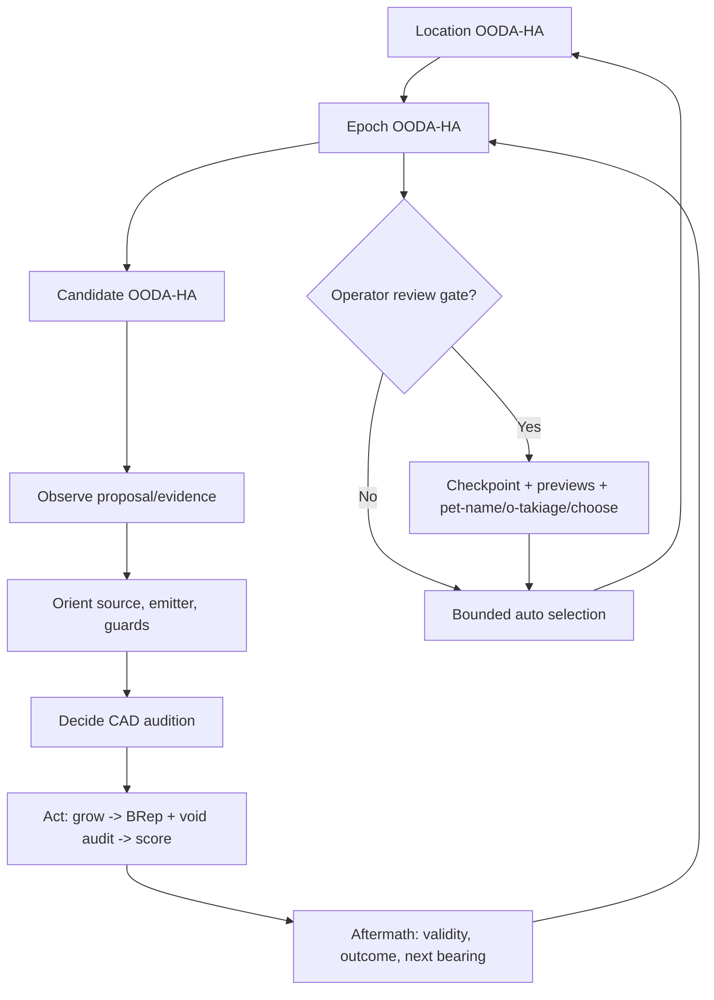

# OODA-HA runs the Loom: executable, fractal control plane

**Authority:** `projection_loom.fractal_ooda_ha` owns the single nested five-phase controller; `WideEpoch` carries bounded CAD candidate evaluations. The noosphere boot governs Observe → Orient → Decide → Act → Hoʻoko/Aftermath, with `closed` marking the boundary after the fifth phase.

## Canonical alpha entrypoint and recoverability

The only runtime Python module name now reads `fractal_ooda_ha.py`.
Callers import `run_ooda_epochs`, `OODAJournal`, and `submit_control`
from `projection_loom.fractal_ooda_ha`. The retired `ooda.py` and its
compatibility shim no longer exist. The CLI keeps its established operator
commands (`ooda-run`, `ooda-steer`, `ooda-status`) because they describe
the operator procedure.

The identity ledger now stores each pet-name or o-takiage control ID, original
command digest, and outcome in the same atomic ledger write as its mutation.
If a process fails after this write and before journal acknowledgement, replay
reads the ledger receipt and repairs the journal without repeating the effect.
A digest mismatch refuses replay. Two files still do not form a general
distributed transaction; this approach addresses the specifically witnessed
local control crash boundary.

The pure `selection.py` exposes two distinct decisions: exact candidate
scheduling and scored review selection. A preview is never structural evidence,
and the two native geometry auditors retain separate truth scopes.

## Rendering and review stay beneath the helm

`review.py` regrows only scored CAD and compound candidates for operator
review. It writes PNG previews, a genome receipt, and a relational witness
from the very construction it renders; `selection.py` admits only already
scored alternatives. The CAD renderer checks exact fused-solid validity,
while the compound renderer checks its separate `composite_valid_for_render`
audit and recipe fingerprint. Neither renderer can promote an artwork to
independent survey evidence.

`gallery.py` regrows distinct compound finalists across completed epoch
records. Only the one `fractal_ooda_ha.run_ooda_epochs` helm opens its
gallery child loop in location Aftermath, records the real Act, reviews native
CAD and polymesh receipts, and closes it. The renderer supplies artifacts and
results, never phase transitions. `tests/test_presentation_boundary.py`
verifies the new port, with full nested-epoch tests retaining behavior
witnesses. Run a new output directory after this code move because the
construction fingerprint necessarily changes.

## Typed evidence and capability receipts

The frozen views in evidence_receipts.py recognize native BRep material,
polygon surfaces, CAD/mesh socket proximity, compound rendering, registered
source frames, operator preferences and capability execution states. A
presentation envelope carries a domain and a status; it cannot provide a
universal validity, structural certificate or source-authenticity flag.

Only CAD audits can admit a fused BRep. Only independent polygon/socket
audits can admit visual compound rendering. Native location-stack
registration validates frames and stated anchors, not actual survey
authenticity. Only an Operator can submit steering preferences, which do
not override geometry. Trusted capability execution receipts have their
own complete/inactive/inactive-dependency/error states, distinct from
candidate scores and visual fitness.

review.py, gallery.py, capability_stack.py and fractal_ooda_ha.py call the
matching typed views at their existing authority boundaries. Native
receipts and persisted schema versions remain unchanged. See the
red-first negative controls in tests/test_evidence_receipts.py.

## Canonical encoding without a universal evidence identity

`provenance_encoding.canonical_json_sha256()` captures only one existing
encoding rule: SHA-256 of sorted, compact UTF-8 JSON with unescaped Unicode.
Five call sites use it while preserving their different domains: exact
candidate checkpoint identity, recipe/operator-bound construction identity,
OODA session identity, shortened relational descriptions and location
snapshots. Strict scopes reject nonfinite JSON; historically permissive
relational/location digests pass `allow_nan=True` explicitly to avoid a
silent identity migration. Neither behavior is a claim of source authenticity.

Hash actual source **bytes** with their original per-source byte-SHA256
contracts, never with a JSON model representation. Keep native BRep,
polymesh, survey and registration validation independent. The regression
vectors in `tests/test_provenance_encoding.py` pin exact byte identity and
reject tampered location snapshots.

## Pure phase-law helpers beneath the single journal

`phase_rules.py` holds the immutable phase sequence and two pure
guards, `next_phase_allowed()` and `child_phase_anchor()`. The five
active phases are Observe, Orient, Decide, Act and Aftermath; `closed`
is their completion boundary. The guards decide whether a parent can
advance or a child can anchor to a phase, checking open children and
bounded depth without any filesystem or event-writing authority.

`fractal_ooda_ha.OODAJournal` remains the only executing authority.
Its `begin()` and `transition()` methods call the guards, then own
all mutation, event receipts, integrity stamps and persistent replay.
`tests/test_phase_rules.py` checks both pure law and persisted journal
behavior, including denial without a file write and child return from
an Act anchor. No geometry audit or external source claim follows
from a phase helper.

## One location, nested loops, five guarded phases

The machine advances `observe -> orient -> decide -> act -> aftermath -> closed`.
The closing boundary can reopen another loop at Observe. Production epochs
normally grow under their location's Act, and CAD candidate loops under their
epoch's Act. **Any active phase** can additionally open a child inquiry; the
child records its immutable `parent_phase` and finishes a full five-phase cycle
before the parent may leave that phase. Neither the parent nor an inquiry can
close with an open child. This recursion is *optional*, not a forced five-way
fan-out. Each transition persists a receipt, not a post-hoc phase label.



The **candidate Act wraps the real CAD operation**. The staged evaluator invokes
its `before_candidate` hook after scheduling and before regrowth and the
`after_candidate` hook after saving its result. On reentry, completed CAD
receipts are never silently re-evaluated. A missed child receipt can be rebuilt
from its saved independent CAD checkpoint.

## Adjustable authority: continuous autonomy [0, 1]

The operator can change a run's policy at safe boundaries. There are four
named waypoints on one continuous gradient:

| Preset | Default autonomy | Operator control | Machine behavior |
|---|---:|---|---|
| `manual` | 0.00 | Operator guides; AI can suggest | Stop at each epoch plan and result review |
| `co-pilot` | 0.40 | Shared guidance | Draft plan automatically; require reviewed selection |
| `auto-nav` | 0.75 | Machine guides, operator can intervene | Select bounded valid elites; honor pause/review/steer commands |
| `full-speed` | 1.00 | Machine selects within existing scope | No optional gates, but still honors explicit pause/review at safe points |

Custom `--autonomy` values choose intermediate policy strengths. Values below
0.25 require a plan approval; below 0.60 require review of candidate previews.
A preferred emitter may influence the next lineage **only within a bounded
measured loss margin**. Operator `choose` may select any validated, scored preview, including a
non-champion that contributes a novel emitter or relational phenotype. Rejected,
deferred and unscored candidates never enter the operator's selectable set. Every mode shares exact
CAD validity, void-route checks, fixed-evidence-camera requirements, provenance
checks, budgets, and archive admission gates.

The command-line policy's autonomous choices currently derive from **deterministic
loss ranking plus bounded operator preference**, not an LLM. The Python
`run_ooda_epochs(..., adviser=callable)` hook admits an external AI adviser that
can propose only an already validated preview option and a rationale; operator
control remains authoritative. No network service or AI-provider credentials
are assumed.

## Hand-off, preview, pet-name, review, o-takiage

`ooda-run` (also the `wide-epoch` CLI) establishes `out/session.json`,
`out/status.json`, individual `out/epoch_NNN.json` CAD checkpoints and a
`out/previews/epoch_NNN/review.json` with actual image previews, genome files,
relational witnesses, CAD-evidence status and losses. The review panel includes
quality-diversity archive elites **and** optional validated alternatives, so
operator judgment can preserve a surprising form the optimizer would discard. A preview is a projection
of newly regrown validated CAD, **not ground-truth survey evidence**.

```bash
# First pass: manual waits on an Observe/Orient/Decide planning checkpoint.
python -m projection_loom ooda-run \
  --project examples/grammar/project.json --out out/ooda \
  --passes 3 --candidates 9 --exact-budget 6 --detail-budget 3 \
  --control manual --topology-locus branch
python -m projection_loom ooda-status --session out/ooda/session.json
python -m projection_loom ooda-steer --session out/ooda/session.json \
  --action approve-plan
# Repeat the identical ooda-run invocation to advance to the candidate review.
# Browse out/ooda/previews/epoch_001/review.json and its PNGs/witnesses.
python -m projection_loom ooda-steer --session out/ooda/session.json \
  --action pet-name --proposal candidate-0002 --target '~p-0003' \
  --name 'Bridge With Opinions' --has bridge
python -m projection_loom ooda-steer --session out/ooda/session.json \
  --action choose --proposal candidate-0002
# Repeat ooda-run to grow the next epoch from the chosen genome.
```

To loosen that name's hold at a future review, queue `--action o-takiage
--name 'Bridge With Opinions'`; or to release an entire fork, specify
`--action o-takiage --proposal candidate-0002 --branch '~p-0003'`.
The location's pet-name and other branches can persist. All such actions run
against a source-linked witness in the epoch's Aftermath and cannot alter the
already-scored generation's frozen ledger.

To intervene during an `auto-nav`/`full-speed` process, another process may queue:

```bash
python -m projection_loom ooda-steer --session out/ooda/session.json --action pause
# The runner stops at the *next candidate/phase safe point*, not mid CAD Boolean.
python -m projection_loom ooda-steer --session out/ooda/session.json --action review
python -m projection_loom ooda-steer --session out/ooda/session.json \
  --action prefer-emitter --emitter topology
python -m projection_loom ooda-steer --session out/ooda/session.json \
  --action set-autonomy --autonomy 0.40
python -m projection_loom ooda-steer --session out/ooda/session.json --action resume
# Reinvoke the same ooda-run arguments if the process has returned.
```

Controls enter immutable inbox files. The single runner applies each once and
appends an event to a digest-checked journal. Controls submitted before a review
that require a review witness wait until the preview becomes available. The
initial run's identity already reserves a default `out/identity-ledger.json`
location, so a pet-name may arrive only after the first preview without making
the original session incompatible.

## Phase-anchored inquiries: deepen attention without forcing recursion

A named loop or nameless location may open a bounded child investigation within
**any** active OODA-HA phase. That inquiry completes its own
`observe -> orient -> decide -> act -> aftermath -> closed` progression. The
parent remains at its original phase until the child closes, and the journal
records both the anchor and the return. An inquiry may itself open another
inquiry inside its own Aftermath (or any other phase), with a configurable
safety budget. The recursion pattern invites attention; it does not require
all five phases to spawn children.

A practical example pauses a manual epoch review, opens a child inside its
Aftermath, and then returns to exactly the same validated preview options:

```bash
python -m projection_loom ooda-steer --session out/ooda/session.json \
  --action open-inquiry --loop epoch-0001 \
  --question 'What does the newly grown gallery connect?'
# Reinvoke the matching ooda-run command to apply the queued control.
python -m projection_loom ooda-status --session out/ooda/session.json
# Read the 'awaiting.loop' inquiry id from the status response:
python -m projection_loom ooda-steer --session out/ooda/session.json \
  --action advance-inquiry --loop '<inquiry-loop-id>' --phase orient \
  --note 'The gallery touches the upper landing'
# Repeat advance-inquiry for decide, act, aftermath, closed, then rerun.
# Each explicit receipt records the Operator/AI pair's observation or decision.
```

`--action open-inquiry` accepts an active parent loop. The phase at the safe
boundary becomes its immutable anchor; an already-closed parent cannot receive
one. `--action advance-inquiry` advances **one legal phase at a time**, and
`--note` records what the Operator/AI pair observed, chose, did, or concluded.
Closing the child restores a suspended plan/review checkpoint, including its
original options. A control delivered during an unsafe change of phase fails
openly rather than acquiring a misleading historical anchor.

The Python API also supports optional `run_ooda_epochs(..., phase_adviser=...)`.
This callback receives a documented snapshot for each epoch phase and can
return either `None` or `{'question': '...'}`. The resulting child blocks the
phase until the Operator/AI pair advances it; no LLM provider comes built in.
The callback cannot waive CAD validity or pretend that written phase notes ran
an external computation. This distinguishes actual candidate Act (real CAD
execution) from inquiry Act (an operator/AI action receipt, with separately
owned tools as appropriate).

Recursion limits default to 12 nested levels and 4096 loops per session;
`--max-depth` and `--max-loops` configure them when starting a fresh run.
An in-flight run retains its limits and input/code fingerprint. Changing those
constraints requires a new session, not a silent mutation of its history.

## Failure, safety and persistence

- **Fractal invariants:** phases never skip ahead; child inquiries can run
  inside Observe, Orient, Decide, Act or Aftermath; the parent cannot exit
  the anchoring phase while any child remains open. Ordinary epoch/candidate
  children continue to grow from parent Act. Finite, configurable recursion
  depth and total-loop budgets prevent accidental runaway fan-out.
- **Durability:** source hashes, code hash (all active Python modules and the
  builder), budgets, deterministic proposal seeds and session identity determine
  reentry. Changed code or sources require a *fork*, never silent in-place resume.
- **No fake geometry:** candidate approvals require a valid fused BRep body and
  authored void route checks; a rejected candidate never receives a selection
  option. Evaluator failure remains separate from construction failure.
- **Boundary of interruptions:** the runner checks its inbox before each CAD
  candidate and at epoch decisions. It cannot forcibly cancel an in-progress
  CadQuery/OpenCascade call. A process crash leaves a runner lock requiring
  manual inspection before removal.
- **Trust boundary:** this initial control inbox is suitable for a trusted
  local Operator/AI pair. It is *not* an authenticated multiuser web service and
  does not implement distributed causal merging, timeouts, or remote notifications.
- **Adviser boundary:** external adviser callbacks suggest choices and reasons;
  the callback may not waive audits or invent options. A pure scoring heuristic
  serves CLI auto-navigation until an actual AI provider is connected.
- **Research boundary:** a repeated, unverified image does not establish
  camera calibration or metric scale. The controller makes this explicit in
  the review receipts and never turns previews into new ground truth.

## Precedents and cautionary notes

- LangGraph's interrupt/checkpoint/resume semantics:
  https://docs.langchain.com/oss/python/langgraph/interrupts
- AWS durable workflows suspend work without holding a process running:
  https://docs.aws.amazon.com/durable-execution/patterns/best-practices/pause-resume/
- Harel-style statecharts: hierarchical state boundaries and guarded transitions.
  https://www.sciencedirect.com/science/article/pii/0167642387900359
- LangGraph human-in-the-loop cautions: after interruptions, node code may
  replay; isolate side effects and persist phase receipts before re-entry.
  https://docs.langchain.com/oss/python/langgraph/interrupts
- Event-sourced persistence: immutable operator interventions and explicit
  run identity rather than mutable undocumented guidance.

These principles inform a small, dependency-light local state machine rather
than importing an agent framework whose failure and replay semantics would
have to be audited independently.

## A single OODA-HA engine runs generative capability DAGs

A pet-named entity can generate multiple complementary geometric representations
through a versioned `CapabilityRecipe`. This does **not** create an alternate
scheduler. The *same* controller opens a capability child under each candidate's
Act; it records Observe, Orient, Decide, real operator Act and Aftermath before
the candidate can close. Manual and opt-in adviser/operator controls retain the
same behavior and provenance as CAD-only searches.

The location's final output also runs inside a real child loop anchored to its
Aftermath. It reopens archived recipes, regrows CAD and surfaces, validates
all native-kernel gates, writes independent STEP/OBJ results and the across-epoch
contact sheet, and then returns to the parent. See
[capability composition](capability-ooda-integration.md).
