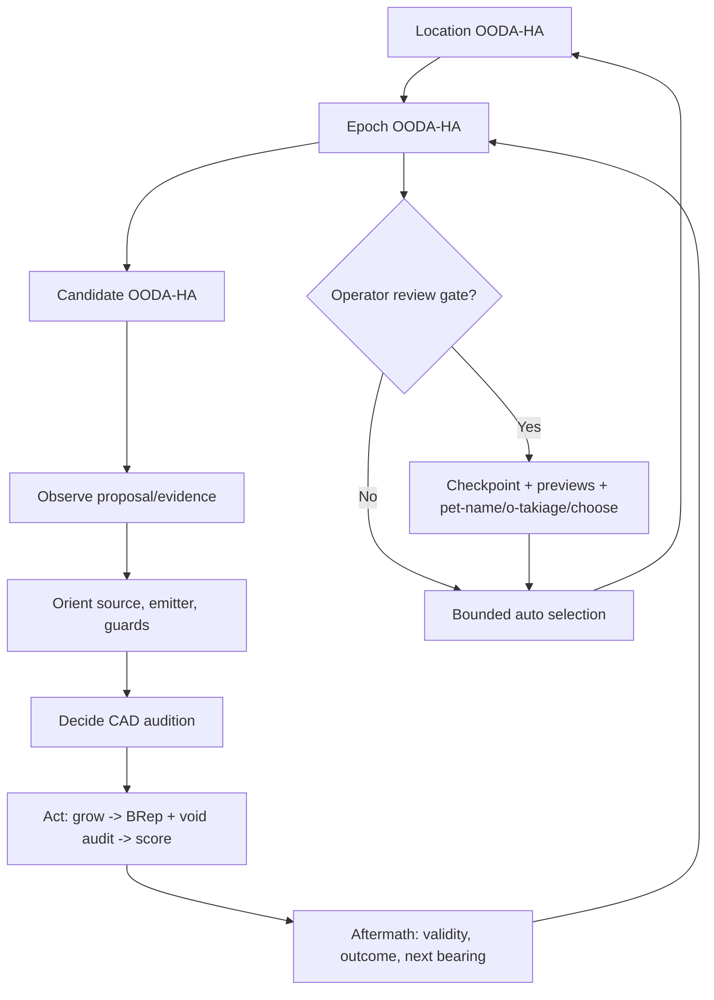

# OODA-HA runs the Loom: executable, fractal control plane

**Authority:** The current `projection_loom.ooda` and `WideEpoch` contracts. The
noosphere boot defines the five-phase practice; this implementation adopts its
sequence as a **runtime state machine**. It does not confuse the developers'
Aftermath/self-review practice with a new architectural material or geometry
feature.

## One location, nested loops, five guarded phases

The machine only advances `observe -> orient -> decide -> act -> aftermath -> closed`.
The closing boundary reopens a subsequent loop at Observe. An epoch may only grow
under the enclosing location's Act; a candidate may only grow under its epoch's
Act. Neither parent may close with an open child. Every transition carries a
persisted receipt, not a comment or log message pretending a transition occurred.



The **candidate Act wraps the real CAD operation**. The staged evaluator invokes
its `before_candidate` hook after scheduling and before regrowth and the
`after_candidate` hook after saving its result. On reentry, completed CAD
receipts are never silently re-evaluated. A missed child receipt can be rebuilt
from its saved independent CAD checkpoint.

## Adjustable authority: continuous autonomy [0, 1]

The operator can change a run's policy at safe boundaries. There are four
named waypoints on one continuous gradient:

| Preset | Default autonomy | Operator control | Machine behavior |
|---|---:|---|---|
| `manual` | 0.00 | Operator guides; AI can suggest | Stop at each epoch plan and result review |
| `co-pilot` | 0.40 | Shared guidance | Draft plan automatically; require reviewed selection |
| `auto-nav` | 0.75 | Machine guides, operator can intervene | Select bounded valid elites; honor pause/review/steer commands |
| `full-speed` | 1.00 | Machine selects within existing scope | No optional gates, but still honors explicit pause/review at safe points |

Custom `--autonomy` values choose intermediate policy strengths. Values below
0.25 require a plan approval; below 0.60 require review of candidate previews.
A preferred emitter may influence the next lineage **only within a bounded
measured loss margin**. Operator `choose` may select any validated, scored preview, including a
non-champion that contributes a novel emitter or relational phenotype. Rejected,
deferred and unscored candidates never enter the operator's selectable set. Every mode shares exact
CAD validity, void-route checks, fixed-evidence-camera requirements, provenance
checks, budgets, and archive admission gates.

The command-line policy's autonomous choices currently derive from **deterministic
loss ranking plus bounded operator preference**, not an LLM. The Python
`run_ooda_epochs(..., adviser=callable)` hook admits an external AI adviser that
can propose only an already validated preview option and a rationale; operator
control remains authoritative. No network service or AI-provider credentials
are assumed.

## Hand-off, preview, pet-name, review, o-takiage

`ooda-run` (also the `wide-epoch` CLI) establishes `out/session.json`,
`out/status.json`, individual `out/epoch_NNN.json` CAD checkpoints and a
`out/previews/epoch_NNN/review.json` with actual image previews, genome files,
relational witnesses, CAD-evidence status and losses. The review panel includes
quality-diversity archive elites **and** optional validated alternatives, so
operator judgment can preserve a surprising form the optimizer would discard. A preview is a projection
of newly regrown validated CAD, **not ground-truth survey evidence**.

```bash
# First pass: manual waits on an Observe/Orient/Decide planning checkpoint.
python -m projection_loom ooda-run \
  --project examples/grammar/project.json --out out/ooda \
  --passes 3 --candidates 9 --exact-budget 6 --detail-budget 3 \
  --control manual --topology-locus branch
python -m projection_loom ooda-status --session out/ooda/session.json
python -m projection_loom ooda-steer --session out/ooda/session.json \
  --action approve-plan
# Repeat the identical ooda-run invocation to advance to the candidate review.
# Browse out/ooda/previews/epoch_001/review.json and its PNGs/witnesses.
python -m projection_loom ooda-steer --session out/ooda/session.json \
  --action pet-name --proposal candidate-0002 --target '~p-0003' \
  --name 'Bridge With Opinions' --has bridge
python -m projection_loom ooda-steer --session out/ooda/session.json \
  --action choose --proposal candidate-0002
# Repeat ooda-run to grow the next epoch from the chosen genome.
```

To loosen that name's hold at a future review, queue `--action o-takiage
--name 'Bridge With Opinions'`; or to release an entire fork, specify
`--action o-takiage --proposal candidate-0002 --branch '~p-0003'`.
The location's pet-name and other branches can persist. All such actions run
against a source-linked witness in the epoch's Aftermath and cannot alter the
already-scored generation's frozen ledger.

To intervene during an `auto-nav`/`full-speed` process, another process may queue:

```bash
python -m projection_loom ooda-steer --session out/ooda/session.json --action pause
# The runner stops at the *next candidate/phase safe point*, not mid CAD Boolean.
python -m projection_loom ooda-steer --session out/ooda/session.json --action review
python -m projection_loom ooda-steer --session out/ooda/session.json \
  --action prefer-emitter --emitter topology
python -m projection_loom ooda-steer --session out/ooda/session.json \
  --action set-autonomy --autonomy 0.40
python -m projection_loom ooda-steer --session out/ooda/session.json --action resume
# Reinvoke the same ooda-run arguments if the process has returned.
```

Controls enter immutable inbox files. The single runner applies each once and
appends an event to a digest-checked journal. Controls submitted before a review
that require a review witness wait until the preview becomes available. The
initial run's identity already reserves a default `out/identity-ledger.json`
location, so a pet-name may arrive only after the first preview without making
the original session incompatible.

## Failure, safety and persistence

- **Fractal invariants:** phase order never skips ahead; children run only in
  parent Act; closing a parent requires all children closed.
- **Durability:** source hashes, code hash (all active Python modules and the
  builder), budgets, deterministic proposal seeds and session identity determine
  reentry. Changed code or sources require a *fork*, never silent in-place resume.
- **No fake geometry:** candidate approvals require a valid fused BRep body and
  authored void route checks; a rejected candidate never receives a selection
  option. Evaluator failure remains separate from construction failure.
- **Boundary of interruptions:** the runner checks its inbox before each CAD
  candidate and at epoch decisions. It cannot forcibly cancel an in-progress
  CadQuery/OpenCascade call. A process crash leaves a runner lock requiring
  manual inspection before removal.
- **Trust boundary:** this initial control inbox is suitable for a trusted
  local Operator/AI pair. It is *not* an authenticated multiuser web service and
  does not implement distributed causal merging, timeouts, or remote notifications.
- **Adviser boundary:** external adviser callbacks suggest choices and reasons;
  the callback may not waive audits or invent options. A pure scoring heuristic
  serves CLI auto-navigation until an actual AI provider is connected.
- **Research boundary:** a repeated, unverified image does not establish
  camera calibration or metric scale. The controller makes this explicit in
  the review receipts and never turns previews into new ground truth.

## Precedents and cautionary notes

- LangGraph's interrupt/checkpoint/resume semantics:
  https://docs.langchain.com/oss/python/langgraph/interrupts
- AWS durable workflows suspend work without holding a process running:
  https://docs.aws.amazon.com/durable-execution/patterns/best-practices/pause-resume/
- Hierarchical statecharts: nested state boundaries and guarded transitions.
- Event-sourced persistence: immutable operator interventions and explicit
  run identity rather than mutable undocumented guidance.

These principles inform a small, dependency-light local state machine rather
than importing an agent framework whose failure and replay semantics would
have to be audited independently.
